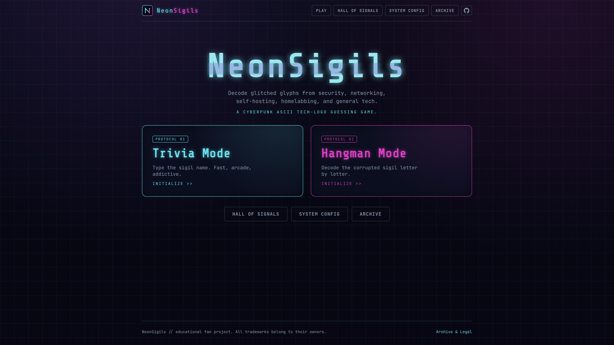
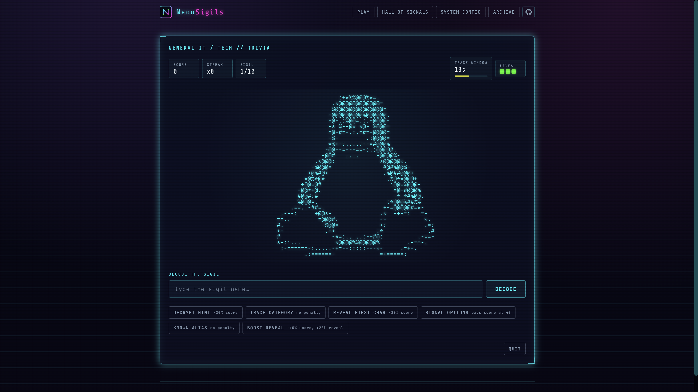
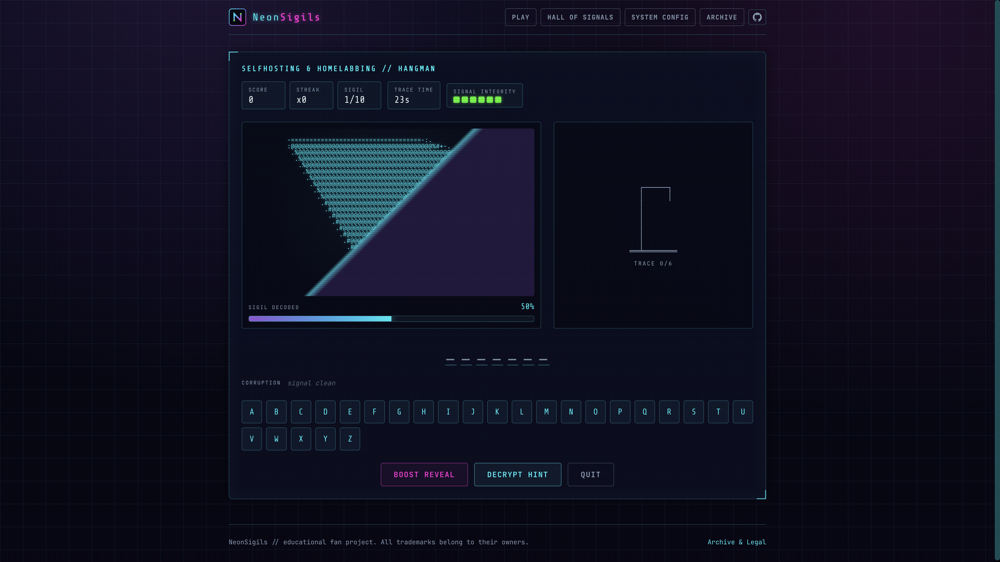

# NeonSigils

A browser game where you identify tech logos rendered as ASCII art. 333 logos from security tooling, the self-hosting scene and general tech, each converted from SVG to text at build time.

**[Play it at neonsigils.cybrsmr.xyz](https://neonsigils.cybrsmr.xyz)**

[](https://github.com/atahan99/NeonSigils/actions/workflows/ci.yml)

| Home | Trivia | Hangman |
| --- | --- | --- |
|  |  |  |

## How it plays

- **Trivia**: an ASCII logo appears and you type its name before the timer runs out. Aliases count (`k8s` is Kubernetes), and close misses get a "near miss" instead of a flat wrong.
- **Hangman**: guess the name letter by letter. Each correct letter wipes more of the logo into view; each wrong one costs a life.
- **Difficulty** changes the puzzle, not only the timer. Harder levels render the logo at fewer columns with a coarser character ramp, hide the word length in Hangman, shorten the clock, and in Expert Hangman the logo slowly re-scrambles while you sit idle.

| | Easy | Medium | Hard | Expert |
| --- | --- | --- | --- | --- |
| ASCII width | 56 cols | 46 cols | 36 cols | 28 cols |
| Trivia timer | 30 s | 20 s | 15 s | 10 s |
| Hangman lives | 6 | 6 | 5 | 4 |
| Score multiplier | ×1.0 | ×1.2 | ×1.5 | ×2.0 |

There are also run modifiers (Sudden Death, Time Attack), a Daily Challenge that gives everyone the same seeded set of logos each day, hints that trade score for help, and a local leaderboard.

## How the ASCII art is made

Nothing is drawn by hand at runtime. A build-time pipeline in [`scripts/`](scripts) turns SVG logos into strings that ship inside the JS bundle:

1. **Resolve an SVG** for each logo by trying sources in order: a local override in `scripts/svg-thesvg/`, the [Simple Icons](https://simpleicons.org/) npm package, [dashboard-icons](https://github.com/homarr-labs/dashboard-icons), [selfh.st/icons](https://selfh.st/icons/), and finally a hand-drawn fallback in `scripts/svg-manual/`.
2. **Rasterize** it with [sharp](https://sharp.pixelplumbing.com/) at a column count set by difficulty. Rows are halved because a monospace cell is about twice as tall as it is wide.
3. **Map luminance to characters** using the ramp ` .:-=+*#%@` (or the shorter ` .:+#@` on Hard and Expert, which makes shapes blockier and harder to read).
4. **Validate** the result: every logo needs at least two hints, a known category and non-empty art.

The output is [`src/data/logos.generated.ts`](src/data/logos.generated.ts), which holds only the clean art. The glitched and cropped frames that harder difficulties show are derived in the browser from that art, seeded by logo id so every player sees the same frame. The archive is split into its own chunk and only downloads once you pick a mode. The deployed site makes no requests to icon CDNs.

## Stack

- React 18, TypeScript, Vite
- Plain CSS with custom properties and CSS Modules
- Hash-based routing, so Back, refresh and links like `#/leaderboard` work on a static host
- Vitest for the game logic; GitHub Actions runs type-check, build, tests and data validation on every push
- `localStorage` for settings and the leaderboard; there is no backend and no account system
- Hosted on Cloudflare Pages, with Cloudflare Web Analytics for page-view counts (no cookies)

## Running it locally

```bash
npm install
npm run dev
```

Other scripts:

| Command | What it does |
| --- | --- |
| `npm run build` | Type-check and build to `dist/` |
| `npm run preview` | Serve the production build |
| `npm test` | Run the unit tests |
| `npm run assets` | Fetch SVGs, regenerate the ASCII data, validate it |

The generated logo data is committed, so you only need `npm run assets` after adding or changing logos.

## Adding a logo

1. Add an entry to the right file in [`src/data/logos/`](src/data/logos) with an `id`, `name`, `aliases`, `difficulty`, `tags`, at least two `hints`, and `sourceCandidates`.
2. Run `npm run assets`.
3. If no source has the brand, draw a simple monochrome SVG in `scripts/svg-manual/` (see the [README there](scripts/svg-manual/README.md)).

## Project layout

```
scripts/            build-time SVG → ASCII pipeline (not shipped)
src/
  components/       layout, shared game UI, hangman pieces
  data/             categories, logo definitions, generated ASCII
  hooks/            game session, settings, sound
  pages/            one component per screen
  utils/            scoring, hints, answer matching, seeded RNG
  **/*.test.ts      unit tests next to the code they cover
public/_headers     security headers for Cloudflare Pages
```

## Trademarks

NeonSigils is a fan-made quiz. Every brand name and logo belongs to its owner, and none of them endorse or sponsor this project. Logos appear only as low-resolution ASCII renderings for the purpose of the game. More detail is on the in-app Archive page.

## License

[MIT](LICENSE) for the code. The license does not cover the third-party logos.
